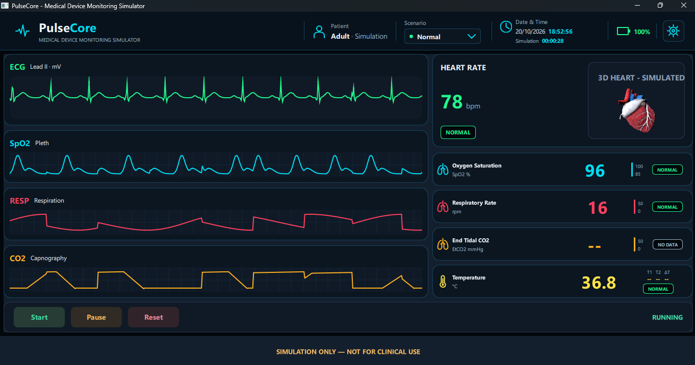

# PulseCore — Medical Device Monitoring Simulator

**PulseCore** is an educational desktop medical device monitoring simulator developed with **C++20, Qt 6, Qt Quick/QML, and Qt Quick 3D**.

The project demonstrates modern desktop software engineering through an interactive monitoring dashboard, animated synthetic ECG visualization, simulated vital signs, and a textured anatomical 3D heart.

PulseCore is being developed incrementally, with each functional module implemented, compiled, tested, and validated before the next development phase.

> **SIMULATION ONLY — NOT FOR CLINICAL USE**
>
> PulseCore is a software engineering demonstration and educational project. It is not a medical device and must not be used for patient monitoring, diagnosis, treatment, or clinical decision-making.

---

## Application Preview

### Medical Device Monitoring Dashboard — Latest Progress (October 20, 2026)

*Current work in progress: synthetic ECG, plethysmography (SpO₂), respiration, and capnography waveforms; simulated vital signs; interactive Start/Pause/Reset controls; and an animated anatomical 3D heart.*

**[▶ Watch the PulseCore development demo (MP4, ~48 seconds)](docs/videos/pulsecore-progress-2026-10-20.mp4)**

### Earlier Dashboard Preview

*Earlier iteration showing the initial ECG monitor, vital sign cards, and Qt Quick 3D heart integration.*

All displayed measurements and waveforms are synthetic. PulseCore is not intended for clinical use.

---

## Project Status

**Current phase:** Active development — dashboard layout, C++ simulation integration, and synthetic monitoring signals.

The current prototype demonstrates a working C++/QML monitoring interface with simulated vital sign updates, ECG sampling, three additional demonstration waveforms, a textured anatomical 3D heart, and simulation controls.

### Implemented Features

- [x] C++20 / Qt 6 project and CMake configuration
- [x] Dark-themed Qt Quick/QML dashboard and reusable UI components
- [x] Centralized visual design tokens in `PulseTheme.qml`
- [x] Synthetic ECG waveform from the simulation layer
- [x] Demonstration plethysmography (SpO₂), respiration, and capnography waveforms generated in QML
- [x] Simulated heart rate, SpO₂, respiratory rate, and temperature displays
- [x] Start, Pause, and Reset simulation controls
- [x] C++ simulation controller integration with QML
- [x] Qt Quick 3D anatomical heart model, materials, rotation, and heartbeat animation
- [x] Educational and non-clinical-use disclaimer

### Work in Progress

- [ ] Dedicated C++ generators for plethysmography, respiration, and capnography
- [ ] CO₂ measurement and other unavailable sensor data
- [ ] Normal, Warning, and Critical scenario selection and behavior
- [ ] Additional bottom navigation and monitoring screens
- [ ] Automated tests, robustness, and distribution

**Current limitation:** Plethysmography, respiration, and capnography curves are visual demonstrations, not acquired sensor signals. The displayed CO₂ measurement remains unavailable. Physiological realism and clinical accuracy are not goals of this prototype.

---

## Technology Stack

| Technology | Purpose |
|---|---|
| C++20 | Application entry point and simulation controller/generators |
| Qt 6.12 | Desktop application framework |
| Qt Quick / QML | User interface and animations |
| Qt Quick 3D | Anatomical heart visualization |
| JavaScript | QML expressions and lightweight UI logic |
| CMake | Project configuration and build system |
| Ninja | Build execution |
| MinGW-w64 | C++ compiler toolchain on Windows |
| Qt Creator | Development environment |
| Qt Test | Planned automated testing framework |

### Development Platform

- Windows 10/11 x64
- Qt Creator
- Qt 6.12 MinGW 64-bit Kit
- C++20-compatible compiler
- CMake
- Ninja

---

## Architecture

PulseCore follows an incremental, component-based architecture designed to separate presentation, simulation logic, and application infrastructure as the project evolves.

### Current Architecture

**Application Entry Point — C++20**

The C++ application initializes the Qt runtime and loads the QML interface.

**Presentation Layer — Qt Quick/QML**

The current presentation layer contains reusable components responsible for displaying the monitoring dashboard and handling basic user interactions.

**3D Visualization — Qt Quick 3D**

The anatomical heart visualization uses an imported 3D model, original texture resources, lighting, and QML animations.

**Simulation and State — C++20 + QML**

The simulation controller exposes state and synthetic vital sign data to QML. QML renders the monitoring interface and generates the additional demonstration waveforms.

### Current QML Components

| Component | Responsibility |
|---|---|
| `Main.qml` | Main application window and dashboard composition |
| `Components/Controls/VitalMonitorCard.qml` | Reusable vital signs monitor card |
| `EcgWaveform.qml` | Synthetic ECG visualization |
| `Components/Monitoring/LeftMonitoringPanel.qml` | ECG, plethysmography, respiration, and capnography display |
| `Components/Monitoring/RightMonitoringPanel.qml` | Heart rate, 3D heart, and vital signs composition |
| `SimulationControls.qml` | Start, Pause, and Reset controls |
| `SimulationButton.qml` | Reusable interactive button |
| `Heart3D/Heart3D.qml` | 3D heart scene, lighting, and animations |
| `Heart3D/Imported/Heart.qml` | Imported anatomical heart model and materials |

### Planned Architecture

The simulation layer is under development. Remaining or planned responsibilities include:

- Additional synthetic waveform generators
- Expanded simulation state handling
- More accurate heartbeat and waveform timing
- Normal, Warning, and Critical scenarios
- Simulated sensor connection states
- Alarm evaluation and notification logic
- Communication between C++ and QML
- Automated tests for simulation behavior

The goal is to maintain clear responsibilities, reusable components, and a separation between application logic and visual presentation.

---

## Simulation Controls

PulseCore provides three interactive controls connected to the simulation controller.

| Control | Current Behavior |
|---|---|
| Start | Starts or resumes the simulated monitoring updates |
| Pause | Pauses simulated monitoring updates |
| Reset | Resets the simulation and clears waveform buffers |

The controls are connected to the C++ simulation controller through QML.

---

## Anatomical 3D Heart

The anatomical heart visualization is implemented with **Qt Quick 3D**.

The model is rendered using its imported geometry, textures, and materials.

### Current Capabilities

- Textured anatomical heart rendering
- Directional lighting
- Perspective camera
- Continuous rotation animation
- Simulated heartbeat scaling animation
- Integration into the monitoring dashboard
- Start and Pause interaction through the current simulation state

The heartbeat animation is a simplified visual effect and is not intended to reproduce medically accurate cardiac mechanics.

### Planned Improvements

- Refined synchronization with simulated heart rate values
- More precise heartbeat animation timing
- Improved animation state handling
- Additional visualization settings
- Enhanced monitoring scenarios

---

## Build and Run

### Prerequisites

Install the following development tools:

1. Qt Creator
2. Qt 6.12 with the MinGW 64-bit Kit
3. CMake
4. Ninja
5. A compatible C++20 compiler

### Build Using Qt Creator

1. Open **Qt Creator**.
2. Select **File → Open File or Project**.
3. Open the project's `CMakeLists.txt`.
4. Select the **Desktop Qt 6.12 MinGW 64-bit** Kit.
5. Configure the project.
6. Build the application using `Ctrl+B`.
7. Run the application using `Ctrl+R`.

The application should open the PulseCore dashboard with its simulated monitoring components and anatomical 3D heart visualization.

### Build Notes

The project uses CMake to register its QML components and the imported 3D model resources.

The Qt Quick 3D module is required to render the anatomical heart.

The appropriate Qt development Kit must be configured before building the project.

---

## Development Roadmap

PulseCore is developed through incremental functional blocks.

### Phase 1 — Project Foundation

- [x] Configure the development environment
- [x] Create the C++20 and Qt application
- [x] Configure CMake and Ninja
- [x] Validate application compilation and execution

### Phase 2 — Monitoring Dashboard

- [x] Create the main application window
- [x] Implement the dark-themed dashboard
- [x] Create reusable vital signs cards
- [x] Implement the synthetic ECG waveform
- [x] Implement simulation control buttons
- [x] Add basic QML simulation states

### Phase 3 — Anatomical 3D Visualization

- [x] Configure Qt Quick 3D
- [x] Import the anatomical heart model
- [x] Configure geometry, textures, and materials
- [x] Implement camera and lighting
- [x] Implement continuous heart rotation
- [x] Implement simulated heartbeat animation
- [x] Integrate the heart visualization into the main dashboard

### Phase 4 — Simulation Engine

- [x] Introduce the C++20 simulation controller and synthetic ECG/vital sign updates
- [x] Connect the simulation controller to QML
- [x] Implement Start, Pause, and Reset controls
- [x] Add demonstration Pleth, Respiration, and Capnography curves in QML
- [ ] Move additional waveform generation into the C++ simulation layer
- [ ] Refine time-based synchronization and simulation scenarios

### Phase 5 — Monitoring Scenarios

- [ ] Implement Normal scenarios
- [ ] Implement Warning scenarios
- [ ] Implement Critical scenarios
- [ ] Add simulated monitoring alarms
- [ ] Add simulated sensor disconnection
- [ ] Implement visual status indicators

### Phase 6 — Quality and Testing

- [ ] Configure Qt Test
- [ ] Add unit tests for the simulation engine
- [ ] Validate state transitions
- [ ] Test simulated monitoring scenarios
- [ ] Add regression tests
- [ ] Validate application stability

### Phase 7 — Distribution

- [ ] Prepare a Windows demonstration build
- [ ] Review application documentation
- [ ] Document known limitations
- [ ] Define project licensing
- [ ] Prepare a portfolio release

---

## Development Principles

The project follows these engineering principles:

- **Incremental Development:** Implement and validate one functional block at a time.
- **Component Reusability:** Prefer reusable QML components over duplicated UI code.
- **Separation of Concerns:** Keep simulation logic independent from presentation.
- **Modern C++:** Use C++20 features where appropriate.
- **Maintainability:** Favor readable code, clear responsibilities, and consistent conventions.
- **Validation:** Compile and verify functionality before completing a development block.
- **Version Control:** Maintain descriptive Git commits for individual file changes whenever practical.
- **Safety:** Clearly identify the application as an educational simulation.

---

## Medical Disclaimer

PulseCore is an educational and portfolio software engineering project.

The application does not connect to medical equipment, acquire real physiological measurements, process real patient data, or provide medical diagnoses.

Displayed vital signs, ECG and other waveforms, heartbeat animations, and monitoring scenarios are synthetic demonstrations.

PulseCore is not validated or certified as a medical device and must not be used for clinical monitoring or medical decision-making.

**SIMULATION ONLY — NOT FOR CLINICAL USE**

---

## License

A license has not yet been selected.

The licensing terms will be defined before public distribution or reuse permissions are granted.

---

## Author

**Alexander Alves**

C++ Developer | Qt/QML | Java | JavaScript | QA Automation Engineer

---

*PulseCore — Engineering interactive medical monitoring simulations with C++20 and Qt.*