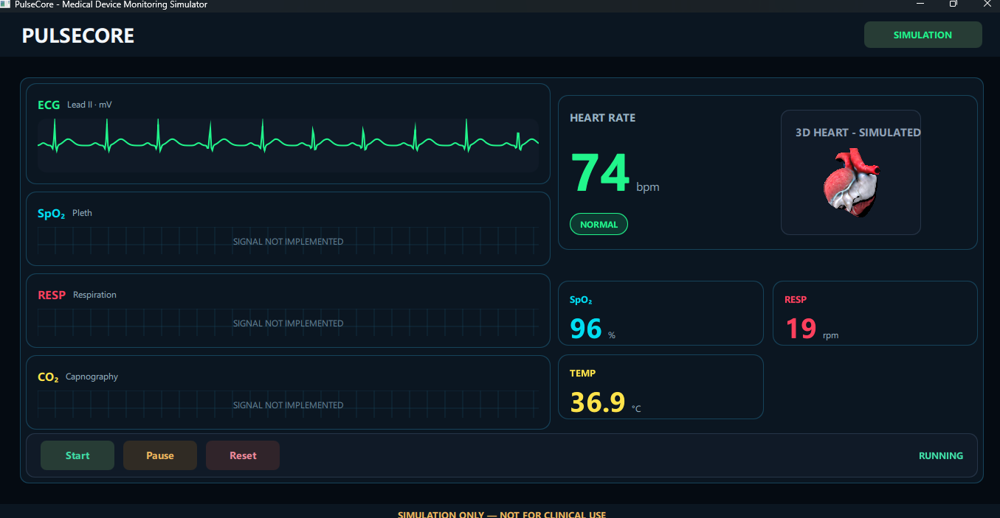

# PulseCore — Medical Device Monitoring Simulator

**PulseCore** is an educational desktop medical device monitoring simulator developed with **C++20, Qt 6, Qt Quick/QML, and Qt Quick 3D**.

The project demonstrates modern desktop software engineering through an interactive monitoring dashboard, animated synthetic ECG visualization, simulated vital signs, and a textured anatomical 3D heart.

PulseCore is being developed incrementally, with each functional module implemented, compiled, tested, and validated before the next development phase.

> **SIMULATION ONLY — NOT FOR CLINICAL USE**
>
> PulseCore is a software engineering demonstration and educational project. It is not a medical device and must not be used for patient monitoring, diagnosis, treatment, or clinical decision-making.

---

## Application Preview

### Medical Device Monitoring Dashboard

The current PulseCore interface provides a dark-themed monitoring dashboard that combines synthetic physiological visualizations with interactive simulation controls.

*PulseCore dashboard featuring an animated synthetic ECG waveform, simulated vital signs, and a textured anatomical 3D heart with rotation and heartbeat animations.*

The interface is implemented using reusable QML components, while Qt Quick 3D provides real-time rendering of the anatomical heart model.

All displayed measurements and animations are simulated and do not represent actual patient information.

---

## Project Status

**Current phase:** Functional QML dashboard and anatomical 3D heart visualization completed.

The application currently includes a working desktop interface with animated visual components and basic simulation state controls.

The next development phases will focus on shared simulation data, C++20 application logic, monitoring scenarios, simulated alarms, and automated testing.

### Implemented Features

- [x] C++20 and Qt 6 project configuration
- [x] CMake-based build configuration
- [x] Qt Quick/QML application interface
- [x] Dark-themed monitoring dashboard
- [x] Reusable QML visual components
- [x] Animated synthetic ECG waveform
- [x] Heart rate (HR) display
- [x] Oxygen saturation (SpO₂) display
- [x] Respiratory rate (RESP) display
- [x] Body temperature (TEMP) display
- [x] Start, Pause, and Reset controls
- [x] Basic simulation state management in QML
- [x] Qt Quick 3D integration
- [x] Anatomical 3D heart model import
- [x] Anatomical heart textures and materials
- [x] Continuous 3D heart rotation
- [x] Simulated heartbeat animation
- [x] Integration of the 3D heart into the main dashboard
- [x] Educational and non-clinical-use disclaimer

**Current limitation:** The displayed vital signs use predefined demonstration values. A dedicated C++ simulation engine, dynamically generated measurements, and clinically meaningful physiological behavior have not been implemented.

---

## Technology Stack

| Technology | Purpose |
|---|---|
| C++20 | Application entry point and planned simulation engine |
| Qt 6.12 | Desktop application framework |
| Qt Quick / QML | User interface and animations |
| Qt Quick 3D | Anatomical heart visualization |
| JavaScript | QML expressions and lightweight UI logic |
| CMake | Project configuration and build system |
| Ninja | Build execution |
| MinGW-w64 | C++ compiler toolchain on Windows |
| Qt Creator | Development environment |
| Qt Test | Planned automated testing framework |

### Development Platform

- Windows 10/11 x64
- Qt Creator
- Qt 6.12 MinGW 64-bit Kit
- C++20-compatible compiler
- CMake
- Ninja

---

## Architecture

PulseCore follows an incremental, component-based architecture designed to separate presentation, simulation logic, and application infrastructure as the project evolves.

### Current Architecture

**Application Entry Point — C++20**

The C++ application initializes the Qt runtime and loads the QML interface.

**Presentation Layer — Qt Quick/QML**

The current presentation layer contains reusable components responsible for displaying the monitoring dashboard and handling basic user interactions.

**3D Visualization — Qt Quick 3D**

The anatomical heart visualization uses an imported 3D model, original texture resources, lighting, and QML animations.

**Simulation State — QML**

The current interface manages basic `RUNNING`, `PAUSED`, and `STOPPED` states. These states control the visual animations and simulation controls.

### Current QML Components

| Component | Responsibility |
|---|---|
| `Main.qml` | Main application window and dashboard composition |
| `VitalCard.qml` | Reusable simulated vital signs card |
| `EcgWaveform.qml` | Animated synthetic ECG visualization |
| `SimulationControls.qml` | Start, Pause, and Reset controls |
| `SimulationButton.qml` | Reusable interactive button |
| `Heart3D/Heart3D.qml` | 3D heart scene, lighting, and animations |
| `Heart3D/Imported/Heart.qml` | Imported anatomical heart model and materials |

### Planned Architecture

Future development will introduce a dedicated C++20 simulation layer responsible for:

- Synthetic vital sign generation
- Centralized simulation state management
- Heartbeat frequency synchronization
- Normal, Warning, and Critical scenarios
- Simulated sensor connection states
- Alarm evaluation and notification logic
- Communication between C++ and QML
- Automated tests for simulation behavior

The goal is to maintain clear responsibilities, reusable components, and a separation between application logic and visual presentation.

---

## Simulation Controls

PulseCore currently provides three interactive controls.

| Control | Current Behavior |
|---|---|
| Start | Activates the visual simulation animations |
| Pause | Stops the visual animations |
| Reset | Changes the simulation state to `STOPPED` and resets the ECG animation offset |

The current controls operate through QML state management.

A future implementation will extend these controls to manage a centralized C++ simulation engine, including more complete pause, resume, and reset behavior.

---

## Anatomical 3D Heart

The anatomical heart visualization is implemented with **Qt Quick 3D**.

The model is rendered using its imported geometry, textures, and materials.

### Current Capabilities

- Textured anatomical heart rendering
- Directional lighting
- Perspective camera
- Continuous rotation animation
- Simulated heartbeat scaling animation
- Integration into the monitoring dashboard
- Start and Pause interaction through the current simulation state

The heartbeat animation is a simplified visual effect and is not intended to reproduce medically accurate cardiac mechanics.

### Planned Improvements

- Synchronization with simulated heart rate values
- Dynamic heartbeat animation speed
- Improved animation state handling
- Additional visualization settings
- Enhanced monitoring scenarios

---

## Build and Run

### Prerequisites

Install the following development tools:

1. Qt Creator
2. Qt 6.12 with the MinGW 64-bit Kit
3. CMake
4. Ninja
5. A compatible C++20 compiler

### Build Using Qt Creator

1. Open **Qt Creator**.
2. Select **File → Open File or Project**.
3. Open the project's `CMakeLists.txt`.
4. Select the **Desktop Qt 6.12 MinGW 64-bit** Kit.
5. Configure the project.
6. Build the application using `Ctrl+B`.
7. Run the application using `Ctrl+R`.

The application should open the PulseCore dashboard with its simulated monitoring components and anatomical 3D heart visualization.

### Build Notes

The project uses CMake to register its QML components and the imported 3D model resources.

The Qt Quick 3D module is required to render the anatomical heart.

The appropriate Qt development Kit must be configured before building the project.

---

## Development Roadmap

PulseCore is developed through incremental functional blocks.

### Phase 1 — Project Foundation

- [x] Configure the development environment
- [x] Create the C++20 and Qt application
- [x] Configure CMake and Ninja
- [x] Validate application compilation and execution

### Phase 2 — Monitoring Dashboard

- [x] Create the main application window
- [x] Implement the dark-themed dashboard
- [x] Create reusable vital signs cards
- [x] Implement the synthetic ECG waveform
- [x] Implement simulation control buttons
- [x] Add basic QML simulation states

### Phase 3 — Anatomical 3D Visualization

- [x] Configure Qt Quick 3D
- [x] Import the anatomical heart model
- [x] Configure geometry, textures, and materials
- [x] Implement camera and lighting
- [x] Implement continuous heart rotation
- [x] Implement simulated heartbeat animation
- [x] Integrate the heart visualization into the main dashboard

### Phase 4 — Simulation Engine

- [ ] Design the C++20 simulation engine
- [ ] Implement centralized simulation state management
- [ ] Generate synthetic vital sign measurements
- [ ] Synchronize the heart animation with simulated HR
- [ ] Connect the simulation engine to QML
- [ ] Implement complete Start, Pause, and Reset behavior

### Phase 5 — Monitoring Scenarios

- [ ] Implement Normal scenarios
- [ ] Implement Warning scenarios
- [ ] Implement Critical scenarios
- [ ] Add simulated monitoring alarms
- [ ] Add simulated sensor disconnection
- [ ] Implement visual status indicators

### Phase 6 — Quality and Testing

- [ ] Configure Qt Test
- [ ] Add unit tests for the simulation engine
- [ ] Validate state transitions
- [ ] Test simulated monitoring scenarios
- [ ] Add regression tests
- [ ] Validate application stability

### Phase 7 — Distribution

- [ ] Prepare a Windows demonstration build
- [ ] Review application documentation
- [ ] Document known limitations
- [ ] Define project licensing
- [ ] Prepare a portfolio release

---

## Development Principles

The project follows these engineering principles:

- **Incremental Development:** Implement and validate one functional block at a time.
- **Component Reusability:** Prefer reusable QML components over duplicated UI code.
- **Separation of Concerns:** Keep simulation logic independent from presentation.
- **Modern C++:** Use C++20 features where appropriate.
- **Maintainability:** Favor readable code, clear responsibilities, and consistent conventions.
- **Validation:** Compile and verify functionality before completing a development block.
- **Version Control:** Maintain descriptive Git commits for individual file changes whenever practical.
- **Safety:** Clearly identify the application as an educational simulation.

---

## Medical Disclaimer

PulseCore is an educational and portfolio software engineering project.

The application does not connect to medical equipment, acquire real physiological measurements, process real patient data, or provide medical diagnoses.

Displayed vital signs, ECG waveforms, heartbeat animations, and monitoring scenarios are synthetic demonstrations.

PulseCore is not validated or certified as a medical device and must not be used for clinical monitoring or medical decision-making.

**SIMULATION ONLY — NOT FOR CLINICAL USE**

---

## License

A license has not yet been selected.

The licensing terms will be defined before public distribution or reuse permissions are granted.

---

## Author

**Alexander Alves**

C++ Developer | Qt/QML | Java | JavaScript | QA Automation Engineer

---

*PulseCore — Engineering interactive medical monitoring simulations with C++20 and Qt.*